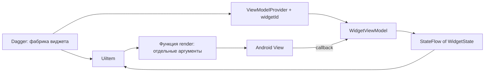

# Архитектура виджетов

UI — императивные Android Views. Compose не используется. Добавлен пример из ТЗ: список голосований, форма с вопросом и двумя ответами,
экран голосования с результатами.

## Модули и ответственность

| Место | Ответственность |
| --- | --- |
| `:ui.designsystem` | View, ресурсы, функции создания и обновления виджетов. Отдельный разработчик UI. |
| `:app` → `ui/widget` | Общие WidgetState, WidgetViewModel, UiItem и lifecycle-привязка. |
| `:app` → `polls` | Конкретные состояния, ViewModel, адаптеры и Dagger-фабрики виджетов, бизнес-логика. |
| Activity / Fragment | Получить фабрики из Dagger, собрать экран и управлять View/lifecycle. |

Зависимость модулей: `app → ui.designsystem`. Обратная зависимость запрещена.
Designsystem ничего не знает о StateFlow, UiItem, ViewModel и бизнес-логике.



## WidgetState

У каждого типа виджета свой `data class`, реализующий маркер `WidgetState`.
Все свойства — `val`; вложенные значения тоже immutable. Один снимок содержит
всё для отрисовки: тексты, числа, цвета, размеры, флаги enabled/selected/loading
и другие параметры конкретного виджета. Цвета передаются как `@ColorInt`, размеры
имеют явную единицу (например, суффикс `Dp` или `Px`).

`val` сам по себе не делает список/массив immutable. Не хранить MutableList,
MutableMap, изменяемые модели, View, Context, Drawable или callbacks в состоянии.
При изменении создаётся новое значение через `copy`. Цвета и локализованные данные
пересчитываются при смене темы/конфигурации, если находятся в состоянии.

Dagger предоставляет фабрику начального состояния. Новые состояния внутри
ViewModel создаются через `copy`/чистый reducer: граф DI не пересобирается при
каждом клике. Ни State, ни ViewModel не регистрируются как singleton виджета.

## WidgetViewModel

Отдельный экземпляр для каждого логического виджета. База `WidgetViewModel<S>`
хранит private MutableStateFlow и выдаёт только `StateFlow<S>` через `asStateFlow`.
Менять состояние снаружи нельзя; UiItem передаёт события в методы ViewModel.

`updateState` выполняет атомарный reducer. Внутри reducer нельзя делать побочные
эффекты, потому что он может быть вызван повторно. Асинхронная логика работает в
`viewModelScope`; зависимости на use case/repository приходят из Dagger.
ViewModel не хранит View, Activity, Fragment и функции, замкнувшие их.

## UiItem и отрисовка

`UiItem<S, V>` содержит ViewModel и две функции: создание View и отрисовку состояния.
Конкретная фабрика адаптирует State к аргументам функции designsystem:

```kotlin
// Внутри фабрики конкретного виджета:
UiItem(
    viewModel = vm,
    create = { parent -> createCounterWidget(parent.context) },
    render = { view, state ->
        renderCounterWidget(
            view = view,
            value = state.value,
            textColor = state.textColor,
            enabled = state.enabled,
            onClick = vm::increment,
        )
    },
)
```

`createCounterWidget` / `renderCounterWidget` здесь обозначают будущий API
разработчика designsystem, а не уже реализованный виджет.

View создаётся один раз через `createView(parent)`, получает актуальное начальное
состояние и возвращается без parent. Хост прикрепляет её к layout. Затем
`bind(view, lifecycleOwner)` собирает StateFlow только в STARTED через
`repeatOnLifecycle` и обновляет существующую View на main thread.

Для Fragment передаётся **viewLifecycleOwner**. Возвращаемый Job необходимо
отменить перед повторным bind или recycle/detach долгоживущего ViewHolder.
Не выполнять bind на каждую эмиссию состояния. Уничтожение lifecycle отменяет
подписку автоматически; при возврате в STARTED рисуется последнее состояние.
Designsystem не отправляет пользовательское событие в ответ на render.

UiItem и View живут вместе с View экрана и создаются заново после поворота.
Не сохранять их в ViewModel и не делать singleton. Это исключает удержание старой
Activity через Context и callback.

## Создание через Dagger

Публичная точка входа каждого виджета — своя injectable-фабрика, например
`CounterUiItemFactory`. Экран получает её через Hilt (`@Inject`), передаёт owner,
стабильный widgetId и при необходимости начальные аргументы. Экран не вызывает
конструкторы State, ViewModel или UiItem.

Для виджета без runtime-аргументов схема такая (шаблон для будущей реализации):

```kotlin
internal data class CounterState(
    val value: Int,
    @ColorInt val textColor: Int,
    val enabled: Boolean,
) : WidgetState

internal class CounterStateFactory @Inject constructor() {
    fun create(): CounterState = /* начальные значения из зависимостей/параметров */
}

internal class CounterViewModel @Inject constructor(
    initialState: CounterStateFactory,
) : WidgetViewModel<CounterState>(initialState.create()) {
    fun increment() = updateState { it.copy(value = it.value + 1) }
}

internal class CounterUiItemFactory @Inject constructor(
    private val viewModels: WidgetViewModels,
    private val provider: Provider<CounterViewModel>,
) {
    fun create(owner: ViewModelStoreOwner, widgetId: String): UiItem<CounterState, CounterView> {
        val vm = viewModels.get(owner, widgetId, CounterViewModel::class.java, provider)
        return UiItem(vm, /* createView */, /* state -> arguments -> render */)
    }
}
```

`WidgetViewModels` объединяет `Provider<VM>` от Dagger с `ViewModelProvider` AndroidX.
Прямой `@Inject lateinit var widgetViewModel` на экране не используется: DI сам по
себе не даёт AndroidX ViewModelStore lifecycle. Для этого пути WidgetViewModel
имеет обычный `@Inject`, **не** `@HiltViewModel`: Hilt запрещает получать
`@HiltViewModel` напрямую через Dagger Provider. Hilt остаётся точкой входа для
Activity/Fragment и injectable-фабрик.

При runtime-аргументах (например, pollId) конкретные State/VM фабрики используют
Dagger `@AssistedInject` / `@AssistedFactory`. В `WidgetViewModels.get` передаётся
`Provider { assistedFactory.create(args) }`. Runtime-аргументы должны быть
стабильны для widgetId: при уже существующей ViewModel фабрика не вызывается.
Изменение текущих данных идёт через события/наблюдение repository, не повторное
создание с тем же ключом.

## Время жизни и идентичность

Согласовано: **ViewModel живёт вместе с экраном**.

- Owner — Fragment или NavBackStackEntry конкретного экрана; Activity подходит,
  только если она и есть весь экран. Несколько экранов не используют общий owner.
- Ключ состоит из класса ViewModel и стабильного widgetId. Два одинаковых типа
  виджетов получают разные ID; позиция в списке и случайный UUID при каждом bind
  не подходят.
- Повторное получение с тем же owner + типом + ID возвращает ту же ViewModel.
- Поворот пересоздаёт View и UiItem, но сохраняет ViewModel через ViewModelStore.
- Удаление View или recycle отменяет подписку, но не очищает ViewModel: она живёт
  до удаления экрана. Окончательное закрытие экрана очищает его ViewModelStore.
- Восстановление после смерти процесса отдельно не реализовано. Для него нужны
  SavedStateHandle/сохраняемые ID и factory с CreationExtras; один StateFlow
  не обеспечивает сохранение между процессами.

## Проверки и дальнейшая работа

Базовые unit-тесты проверяют изоляцию экземпляров, повторное получение по ключу,
очистку при закрытии экрана, остановку/возобновление подписки и отмену при unbind.
Также проверяются валидация формы, запрет повторного создания, неизменяемость
старого снимка и изоляция голосований. Всего 5 обычных JVM-тестов без Robolectric.

Источники решений: [ViewModel factories](https://developer.android.com/topic/libraries/architecture/viewmodel/viewmodel-factories),
[lifecycle-aware collection](https://developer.android.com/topic/libraries/architecture/coroutines),
[Dagger assisted injection](https://dagger.dev/dev-guide/assisted-injection.html).

## Реализованный пример

В `polls/PollUiItems.kt` находится injectable-фабрика для экрана. Она получает
Dagger Provider/AssistedFactory и использует `WidgetViewModels` со стабильными ключами.
Фрагменты передают `this` как ViewModelStoreOwner и `viewLifecycleOwner` для bind.

| Компонент designsystem | Состояние | ViewModel | Ключ |
| --- | --- | --- | --- |
| PollCard | PollCardState | PollCardViewModel | poll:<id> |
| TextField | TextFieldState | TextFieldViewModel | field:<QUESTION/FIRST/SECOND> |
| ActionButton | ActionButtonState | ActionButtonViewModel / SubmitButtonViewModel | new-poll / submit |
| PollOption | PollOptionState | PollOptionViewModel | poll:<id>:<FIRST/SECOND> |

`WidgetStateFactory` через Dagger создаёт начальные состояния, локализованные строки
и immutable `WidgetAppearance` (цвета, размеры, типографика). При пересоздании View
фабрики обновляют оформление сохранённой ViewModel под текущую конфигурацию.
Каждое поле имеет свою ViewModel; `DraftViewModel` объединяет данные формы и валидацию.
Он живёт в том же хранилище экрана. `PollRepository` — общий in-memory источник
голосований, предоставленный Hilt как Singleton. Состояния самих виджетов не singleton.

Нажатие варианта вызывает `PollOptionViewModel.vote()`, затем repository публикует
новый список. ViewModel обоих вариантов и карточки получают обновление и создают
новые WidgetState; UiItem раскладывает их в аргументы функций `render*`.
Для добавления нового типа виджета повторяется эта же цепочка.

Навигация реализована через три Fragment и `res/navigation/polls.xml`.
Данные не переживают смерть процесса: экран отсутствующего голосования показывает
сообщение вместо падения. Сервер, авторизация и долговременное хранение не добавлены.
